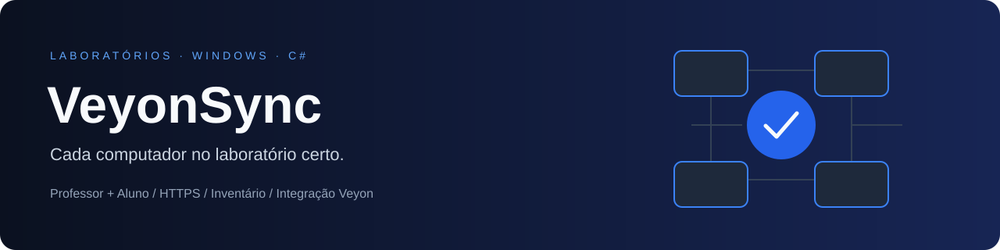

<p align="center"></p>

<p align="center">
  
  
  
  
</p>

<p align="center">Inventário de computadores, comunicação entre aluno e professor e atualização assistida do diretório Veyon.</p>

<p align="center"><a href="#começar">Começar</a> · <a href="docs/architecture.md">Arquitetura</a> · <a href="docs/design.md">Design</a> · <a href="docs/troubleshooting.md">Diagnóstico</a> · <a href="docs/validation.md">Validação</a></p>

## O projeto

O VeyonSync identifica os computadores de cada laboratório por uma identidade persistente. O agente **Aluno** informa posição, nome, usuário da sessão do console, IP e MAC ao serviço **Professor**. O professor mantém o inventário e o histórico, autoriza agentes e oferece uma prévia antes de aplicar cadastros no Veyon.

**Pré-lançamento:** o código compila e os testes automatizados da base são executáveis em Linux. A interface, os instaladores e o fluxo completo dos serviços precisam de validação em Windows. A integração também precisa de um teste com a versão real do Veyon. Consulte [o registro de validação](docs/validation.md) antes de distribuir em um laboratório.

## O que está implementado

| Professor | Aluno |
|---|---|
| Dashboard, grade/lista, busca e detalhes por computador | Visão geral e envio manual |
| Pareamento de uso único por 15 minutos e revogação | Assistente de pareamento em seis etapas |
| Histórico persistente com filtros e exportação CSV | Preservação de pendências e tentativas com espera progressiva |
| Diagnóstico e exportação TXT | Identificação da sessão de console e interface de rede |
| Prévia, backup, importação e conferência do Veyon | Estado do recebimento e da integração separados |
| Retenção configurável do histórico | Modo automático ou manual |

As interfaces compartilham tema escuro padrão, tema claro, opção de seguir o Windows, menu recolhível e transições que respeitam a configuração de animação do sistema. As janelas exigem elevação administrativa; os serviços continuam funcionando quando elas são fechadas.

**Sem dados fictícios:** serviço indisponível aparece como indisponível. “Comunicação recente” não significa que o Veyon Master confirmou disponibilidade da máquina.

## Começar

### Para desenvolver

Requisitos: .NET SDK indicado em [global.json](global.json) e PowerShell 7 para gerar pacotes. As aplicações são Windows x64; o SDK inclui os compiladores, e o restore fornece as referências do WPF.

```powershell
dotnet restore VeyonSync.slnx --locked-mode -p:EnableWindowsTargeting=true
dotnet build VeyonSync.slnx -c Release --no-restore
dotnet test tests/VeyonSync.Tests/VeyonSync.Tests.csproj -c Release --no-build
pwsh ./scripts/build.ps1
```

Os pacotes independentes de Professor e Aluno e seus checksums são gerados em `artifacts/`. Incluem o runtime .NET: o computador de destino não precisa do SDK nem do runtime previamente instalado. Os pacotes são ZIPs com instalação por script; não são MSI nem executáveis assinados.

### Para instalar no Windows

Use primeiro uma máquina de teste. Alvo inicial: Windows 10 Pro 22H2 x64 ou Windows 11 compatível com .NET 10. Windows 10 exige considerar o ciclo de suporte/ESU do sistema; builds antigos como 1607 não são aceitos pelo instalador.

1. Gere os pacotes ou baixe os artefatos de uma execução bem-sucedida do GitHub Actions. Confira `SHA256SUMS.txt`.
2. Extraia `VeyonSync-Teacher-win-x64.zip` no professor. Execute `INSTALL.bat` como administrador e informe o laboratório.
3. Abra **VeyonSync Teacher** no menu Iniciar. Em **Pareamento**, gere um código.
4. Distribua somente `C:\ProgramData\VeyonSync\Teacher\professor.cer` por um meio confiável. Confira a impressão digital SHA-256 com o administrador.
5. Extraia `VeyonSync-Student-win-x64.zip` no aluno e execute `INSTALL.bat` como administrador.
6. Abra **VeyonSync Student** e conclua o assistente: laboratório, endereço HTTPS do professor, certificado público, posição, código e teste.
7. Confirme o recebimento na interface e o cadastro no professor. Cada aluno precisa de um código novo.

Para integrar com o Veyon, configure o caminho do `veyon-cli.exe`, selecione um computador em **Integração**, confira a prévia e escolha **Criar backup e aplicar**. Veja [as regras de integração](docs/veyon.md).

A política de execução do PowerShell da sua organização continua valendo. Se o Windows bloquear scripts baixados, confira origem e checksum e siga a orientação do administrador para desbloquear os arquivos. Não desative validação de TLS, assinaturas ou políticas corporativas para instalar.

## Estrutura

```text
src/
  VeyonSync.Core/          Modelos, SQLite, certificados, IPC e adaptador Veyon
  VeyonSync.Teacher/       Serviço HTTPS + administração local
  VeyonSync.Student/       Coleta, fila persistente e envio
  VeyonSync.Desktop/       Componentes WPF compartilhados
  VeyonSync.Teacher.App/   Aplicativo administrativo do professor
  VeyonSync.Student.App/   Aplicativo administrativo do aluno
tests/VeyonSync.Tests/     Testes da base, certificados e adaptador
scripts/                  Build, instalação, reparo, remoção e smoke test Windows
docs/                     Projeto, operação, validação e publicação
```

## Segurança e contribuição

Não envie certificados privados, tokens, códigos, bancos ou diagnósticos com dados pessoais para o Git. Leia [SECURITY.md](SECURITY.md) e [CONTRIBUTING.md](CONTRIBUTING.md). Para preparar a página e o lançamento público do repositório, veja [GitHub e publicação](docs/github.md).

## Próximos passos de validação

- Executar o smoke test dos serviços no Windows e testar a interface com teclado, DPI e redimensionamento.
- Confirmar integração e restauração com a versão instalada do Veyon.
- Capturar screenshots reais depois da validação visual; o banner acima é identidade gráfica, não uma captura da aplicação.
- Escolher licença de distribuição e, se necessário, assinar os binários e instaladores.

O projeto não é afiliado ao Veyon. A licença de distribuição deste código ainda será definida pelo proprietário; veja [NOTICE.md](NOTICE.md).
