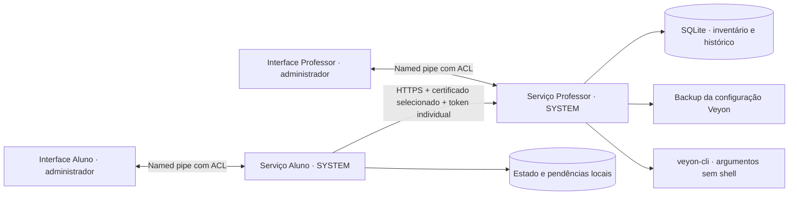

# Arquitetura

## Processos e privilégios

As interfaces WPF exigem elevação pelo manifesto. Uma conta comum precisa de credenciais administrativas conforme a política do Windows; uma conta administradora pode receber apenas a confirmação UAC. O programa não armazena senha administrativa.

As interfaces não abrem o banco nem leem o token do aluno. O acesso administrativo usa pipes locais `VeyonSync.Teacher.v1` e `VeyonSync.Student.v1`, com ACL permitindo Administradores e SYSTEM. O servidor aceita ações conhecidas e serializa a administração. Operações recebem timeout. A execução de comandos usa `ProcessStartInfo.ArgumentList`, sem shell.

## Dados

Dados por função em `%ProgramData%\VeyonSync\Teacher` e `Student`. Binários em `%ProgramFiles%\VeyonSync\<função>`. A instalação aplica ACL nova aos dados e arquivos existentes, removendo permissões explícitas anteriores e rejeitando links/reparse points. Uma configuração JSON inválida provoca erro; não é silenciosamente substituída por outra vazia.

O aluno persiste um contador antes de enviar, independentemente do relógio após sua inicialização. Cada tentativa coleta o estado atual, preserva a pendência até receber confirmação e aguarda progressivamente em falhas. O professor registra inventário e eventos na mesma transação SQLite. Relatórios fora de ordem não sobrescrevem o estado mais novo. Repareamento autoriza uma nova sequência, preservando histórico.

O identificador usa UUID persistido e mudança do MachineGuid do Windows invalida credenciais clonadas. **Isso não resolve imagens Windows clonadas sem generalização que preservem o mesmo MachineGuid**: use Sysprep antes da distribuição e pareie cada instalação individualmente.

As tabelas da etapa 1 são mantidas; novas tabelas guardam integração e versão do esquema. O reparo salva cópia dos arquivos de dados com o serviço parado. O histórico do professor tem retenção configurável; a poda ocorre diariamente, na inicialização e quando a retenção é alterada. O aluno mantém no máximo 500 eventos. O inventário não é apagado pela retenção.

## Rede e certificados

O professor escuta HTTPS na porta configurada (padrão 5443). O firewall limita a sub-rede local em perfis Domínio/Privado. Alunos em outras VLANs exigem regras específicas aprovadas pelo administrador; o instalador não abre acesso irrestrito.

O certificado público selecionado é uma âncora de confiança restrita ao VeyonSync. O cliente verifica impressão digital SHA-256, nome do destino, validade, cadeia e uso para servidor TLS. Não instala uma raiz global. O certificado local autoassinado não possui serviço de revogação; rotação e redistribuição explícita são o mecanismo de substituição. Certificados não selecionados continuam dependendo da validação padrão do sistema.

Pareamento: código aleatório de oito dígitos, uso único, validade de 15 minutos e cinco tentativas por minuto por IP. Gerar um código novo invalida o anterior. Tokens têm 256 bits aleatórios; o professor guarda SHA-256 e o aluno guarda o token com DPAPI LocalMachine mais ACL. Um administrador local continua tendo controle da máquina; DPAPI LocalMachine não é isolamento entre usuários se o arquivo estiver acessível.

## Estado e interface

Recebimento pelo professor, aplicação do cadastro Veyon e disponibilidade no Veyon Master são estados diferentes. Não existe medição de disponibilidade do Master nesta versão. A interface atualiza o snapshot a cada cinco segundos, usa horário local do Windows para exibição e guarda timestamps UTC.

O modo manual não faz tráfego periódico; o botão de diagnóstico faz um pedido HTTPS explícito. Pedidos de coleta ficam no professor até a próxima comunicação do aluno. O botão manual continua disponível.
